# دليل استخدام ChinaPlanetOS Customer Center

الإصدار: 2.5 — بيئة التدريب المحلية
آخر تحديث: 15 يوليو 2026
النطاق: إدارة العميل، التمويل، الموردين، فواتير الخدمات، الشحن، ومستندات التصدير

> هذا الدليل مخصص للموظفين. البيانات الظاهرة في الصور هي بيانات تدريب محلية. لا تُدخل بيانات حقيقية في بيئة التدريب.

## 1. ما الذي يديره النظام؟

ChinaPlanet Customer Center ليس متجرًا إلكترونيًا عاديًا. النظام يفصل بوضوح بين ثلاثة أشياء:

1. **الطلب أو المشروع:** ما طلب العميل من ChinaPlanet إدارته.
2. **محفظة العميل:** الأموال التي حوّلها العميل إلى ChinaPlanet وما تم صرفه نيابةً عنه.
3. **فاتورة Vision:** المبلغ الذي تستحقه Vision مقابل خدماتها الفعلية، مثل العمولة والشحن وCargoX والتفتيش.

سير العمل الصحيح:

```text
العميل يؤكد الطلب
        ↓
يحوّل المال إلى ChinaPlanet
        ↓
ChinaPlanet تدفع عربون المورد ثم الرصيد
        ↓
Vision تصدر فاتورة خدماتها فقط
        ↓
إنشاء الشحنة ومستندات التصدير
        ↓
إغلاق المشروع بعد اكتمال الدفع والشحن والمستندات
```

### قاعدة محاسبية مهمة

- أموال شراء البضاعة ليست دخلًا لـ Vision؛ هي أموال عميل مُدارة.
- العمولة والشحن وCargoX وDHL والتفتيش والخدمات الأخرى هي إيراد Vision عندما تصدر بها فاتورة عميل.
- Commercial Invoice وPacking List مستندات تصدير، وليسا بديلًا عن فاتورة خدمات Vision داخل Dolibarr.
- لا تجمع RMB وUSD وEGP مباشرة. كل عملة لها رصيد مستقل، ولا تُحوّل إلا بسعر صرف مسجل.

## 2. الدخول إلى النظام المحلي

الرابط المحلي:

`http://127.0.0.1:8088`

حساب تدريب China Gate:

- اسم المستخدم: `china.gate.portal`
- كلمة المرور المحلية: `ChinaGateLocal2026!`

> غيّر كلمة المرور ولا تستخدمها في بيئة الإنتاج.

بعد دخول الموظف الإداري، افتح **Customer Center** ثم **Admin Dashboard** أو افتح مباشرة:

`http://127.0.0.1:8088/custom/chinaplanetcustomercenter/admin_dashboard.php`

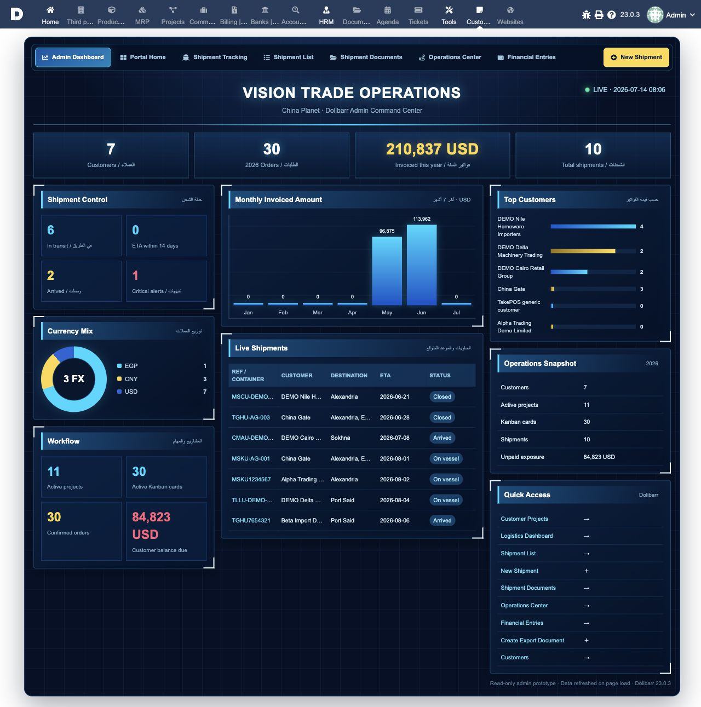

### 2.1 تخصيص لوحة الإدارة

يمكن لكل مستخدم إداري ترتيب لوحته الخاصة دون تغيير لوحة المستخدمين الآخرين.

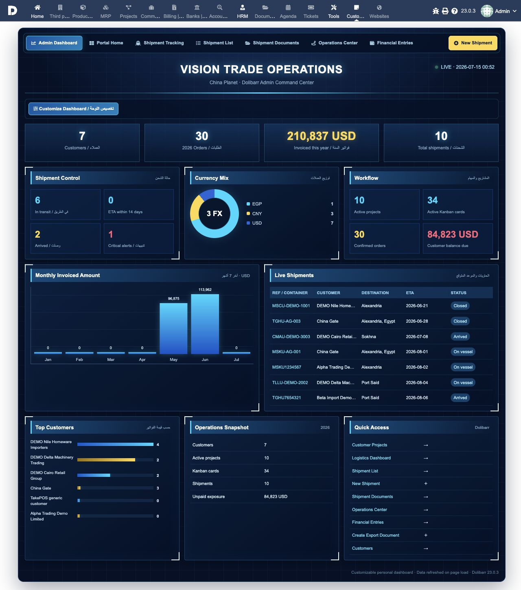

1. اضغط **Customize Dashboard / تخصيص اللوحة**.
2. لتحريك بطاقة، اسحبها من مقبض **↕** إلى المكان المطلوب. يمكن أيضًا تحديد المقبض واستخدام أسهم لوحة المفاتيح.
3. اضغط **↔** للتبديل بين الأحجام: صغير، متوسط، كبير، وعرض كامل.
4. اضغط **×** لإخفاء البطاقة.
5. افتح **Widget Library / مكتبة البطاقات** لإظهار بطاقة مخفية أو إخفائها.
6. اضغط **Save Layout / حفظ التخطيط** لتثبيت الترتيب والحجم والبطاقات الظاهرة.
7. استخدم **Cancel / إلغاء** لترك التغييرات غير المحفوظة، أو **Reset / افتراضي** للعودة إلى تصميم النظام الأصلي.

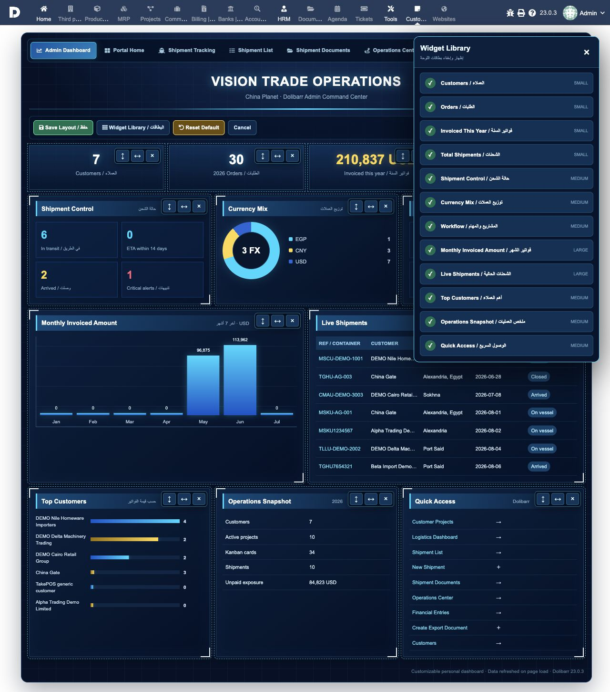

> يتم حفظ التخطيط لكل مستخدم ولكل شركة Dolibarr على حدة. لا يؤدي ترتيب البطاقات أو إخفاؤها إلى حذف البيانات.

### 2.2 التنقل داخل مركز الإدارة

جميع الأقسام التشغيلية الأساسية تعمل الآن داخل إطار **VISION TRADE OPERATIONS** نفسه. يبقى شريط القائمة في أعلى الصفحة، ويتغير المحتوى أسفله مع تمييز القسم المفتوح:

- Admin Dashboard
- Portal Home
- Shipment Tracking
- Shipment List
- Shipment Documents
- Export Docs
- Operations Center
- Financial Entries
- New Shipment

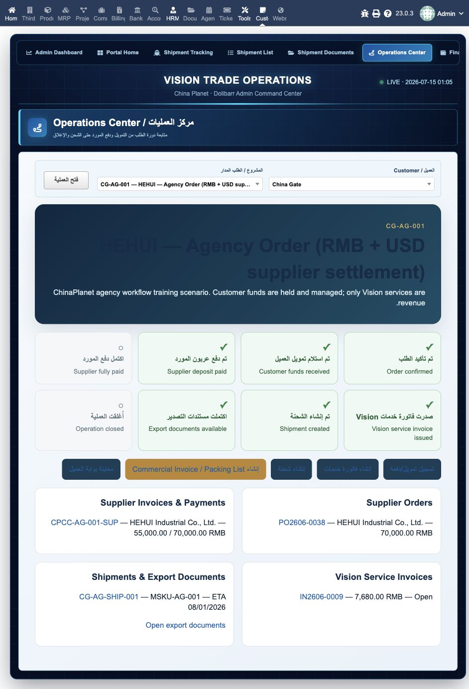

عند اختيار عميل أو مشروع، يحافظ النظام على هذا السياق عند الانتقال بين الصفحات التي تدعمه. ويشمل الإطار الموحد أيضًا: كشف الحساب، التمويل المطلوب، المشاريع وتفاصيلها، الطلبات وتفاصيلها، فواتير الخدمات وتفاصيلها، مستندات التصدير ومعاينتها، التقارير المالية، إعدادات الشحن، وبطاقات Kanban. لذلك لا تظهر قائمة Dolibarr اليسرى داخل هذه الصفحات.

واجهة العميل الخارجي لا تعرض روابط الإدارة، وتظل خاضعة لنطاق شركته فقط. أما روابط **Dolibarr Advanced / السجل المتقدم** فهي مخصصة للموظف ذي الصلاحية، وموسومة بوضوح وتُفتح في تبويب مستقل حتى تبقى لوحة التشغيل مفتوحة.

## 3. مركز العمليات — نقطة البداية اليومية

افتح:

`Customer Center → Operations Center`

أو:

`http://127.0.0.1:8088/custom/chinaplanetcustomercenter/admin/operations.php`

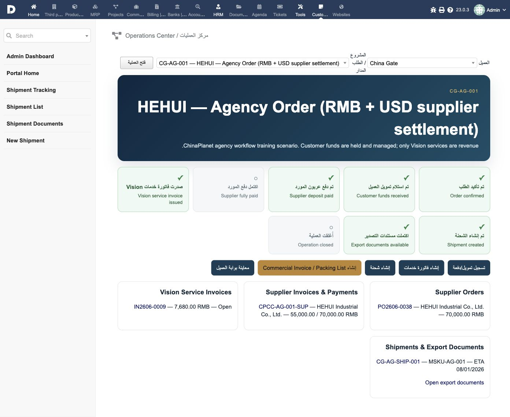

### طريقة الاستخدام

1. ابحث باسم العميل، مثل **China Gate**.
2. اختر المشروع أو الطلب المدار.
3. اضغط **فتح العملية**.
4. راجع مراحل العملية الثماني:

   - تم تأكيد الطلب.
   - تم استلام تمويل العميل.
   - تم دفع عربون المورد.
   - اكتمل دفع المورد.
   - صدرت فاتورة خدمات Vision.
   - تم إنشاء الشحنة.
   - اكتملت مستندات التصدير.
   - أُغلقت العملية.

5. استخدم الأزرار السريعة لإنشاء دفعة، فاتورة خدمة، شحنة، أو مستند تصدير.

### كيف تتغير علامات دورة العملية؟

العلامات الثماني **محسوبة تلقائيًا** عند فتح مركز العمليات، ولا يقوم الموظف بتحديدها يدويًا:

- **Order confirmed:** يظهر بعد وجود طلب عميل معتمد مرتبط بالمشروع.
- **Customer funds received:** يظهر بعد تسجيل استلام أو رصيد افتتاحي مرتبط بالمشروع.
- **Supplier deposit paid:** يظهر بعد تخصيص أي مبلغ لالتزام مورد في المشروع.
- **Supplier fully paid:** يظهر عندما يصبح المتبقي في كل التزامات الموردين صفرًا.
- **Vision service invoice issued:** يظهر بعد اعتماد فاتورة عميل مرتبطة بالمشروع.
- **Shipment created:** يظهر فور حفظ شحنة مرتبطة بنفس العميل والمشروع.
- **Export documents complete:** يظهر بعد وجود Commercial Invoice وPacking List معتمدتين وظاهرتين للعميل.
- **Operation closed:** يظهر بعد اكتمال المراحل المطلوبة، سداد فواتير الخدمات، وإغلاق كل الشحنات المرتبطة.

> إذا أنشأت شحنة بدون اختيار المشروع الصحيح فلن تظهر علامة **Shipment created** لذلك المشروع. تأكد دائمًا من حقلي Customer وProject عند إنشاء الشحنة. مرّر مؤشر الفأرة أو ركّز بلوحة المفاتيح على أي مرحلة لقراءة شرطها.

### متى نغلق المشروع؟

أغلقه فقط عندما:

- يُدفع المورد بالكامل.
- تُسوى فاتورة خدمات Vision أو يُعتمد بقاؤها مستحقة.
- تكتمل الشحنة أو التسليم.
- تتوفر المستندات المطلوبة.
- لا توجد نقطة تشغيلية مفتوحة.

## 4. إنشاء مشروع/طلب مُدار جديد

أنشئ مشروع Dolibarr لكل طلب مستقل، حتى لو كان المورد نفسه.

مثال صحيح:

- HEHUI — Order 1
- HEHUI — Order 2
- HEHUI — Order 3

HEHUI مورد واحد، لكن الطلبات مشاريع منفصلة.

### الحقول المقترحة

- **Customer:** العميل صاحب الأموال.
- **Project Ref:** مرجع فريد، مثال `CG-AG-004`.
- **Title:** اسم المورد + رقم الطلب + وصف مختصر.
- **Start/End date:** تاريخ التأكيد والموعد المتوقع للإغلاق.
- **Description:** نطاق البضاعة والخدمات وملاحظات التشغيل.
- **Status:** Active أثناء التنفيذ، ثم Closed عند الاكتمال.

### Customer Sales Order

يعبّر Sales Order عن الخدمات التي طلب العميل من Vision تنفيذها. في نموذج الوكالة الحالي، أضف بنود الخدمات مثل:

- Order management commission
- Shipping management
- CargoX
- Inspection
- DHL/document courier

لا تضف كامل قيمة بضاعة المورد كإيراد Vision ما لم تكن Vision هي البائع الحقيقي للبضاعة.

## 5. تسجيل الأموال في محفظة العميل

افتح من مركز العمليات **تسجيل تمويل/دفعة**.

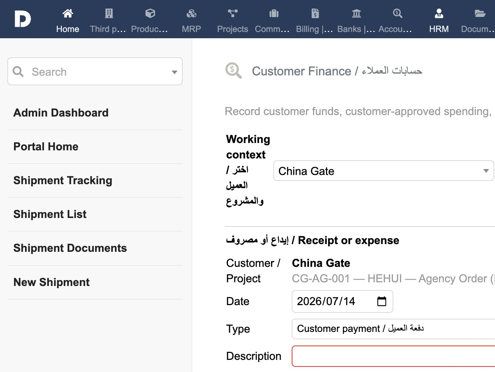

### 5.1 استلام إيداع من العميل

اختر:

- **Type:** Customer Receipt
- **Direction:** Credit
- **Currency:** العملة التي وصلت فعلًا إلى البنك
- **Amount:** المبلغ الفعلي
- **Bank/Reference:** البنك والمرجع البنكي
- **Project:** المشروع إذا كان التحويل مخصصًا له
- **Description:** وصف واضح، مثل `China Gate deposit for CG-AG-004`

مثال:

```text
Received: 100,000 EGP
Direction: Credit
Reference: HSBC-EGP-2026-004
```

### 5.2 دفع مبلغ إلى مورد بنفس العملة

اختر:

- **Type:** Supplier Payment
- **Direction:** Debit
- **Charge/Commitment:** التزام المورد الصحيح
- **Amount/Currency:** المبلغ والعملة الفعلية
- **Allocated Amount/Currency:** يساويان المبلغ والعملة إذا لم يوجد تحويل

مثال:

```text
Paid: 20,000 RMB
Allocated: 20,000 RMB
```

### 5.3 دفع المورد بعملة مختلفة

سجّل العملة التي خرجت من البنك، ثم المبلغ الذي سُدد من فاتورة المورد بعملتها.

مثال السيناريو المختلط:

```text
Actual bank payment: 5,000 USD
Allocated to supplier invoice: 35,000 RMB
Recorded rate: 7 RMB per USD
```

بهذه الطريقة ينخفض رصيد USD بمقدار 5,000، وتنخفض مديونية المورد بـ 35,000 RMB.

### 5.4 ممنوعات مهمة

- لا تسجل تحويل العميل مرتين: مرة كمحفظة ومرة كدفعة فاتورة جديدة.
- لا تستخدم سعر صرف تقريبي بدون تسجيله.
- لا تربط دفعة المورد بمشروع مختلف.
- لا تغير العملة بعد اعتماد الحركة؛ صححها بحركة عكسية موثقة إذا لزم.

## 6. الالتزامات والمبلغ الإضافي المطلوب

صفحة التمويل تطبق المعادلة التالية لكل عملة:

```text
المتبقي للموردين
+ الخدمات والشحن المتوقعة والمعتمدة
+ فواتير Vision الصادرة وغير المدفوعة
− رصيد العميل المتاح وغير المخصص
= المبلغ الإضافي المطلوب من العميل
```

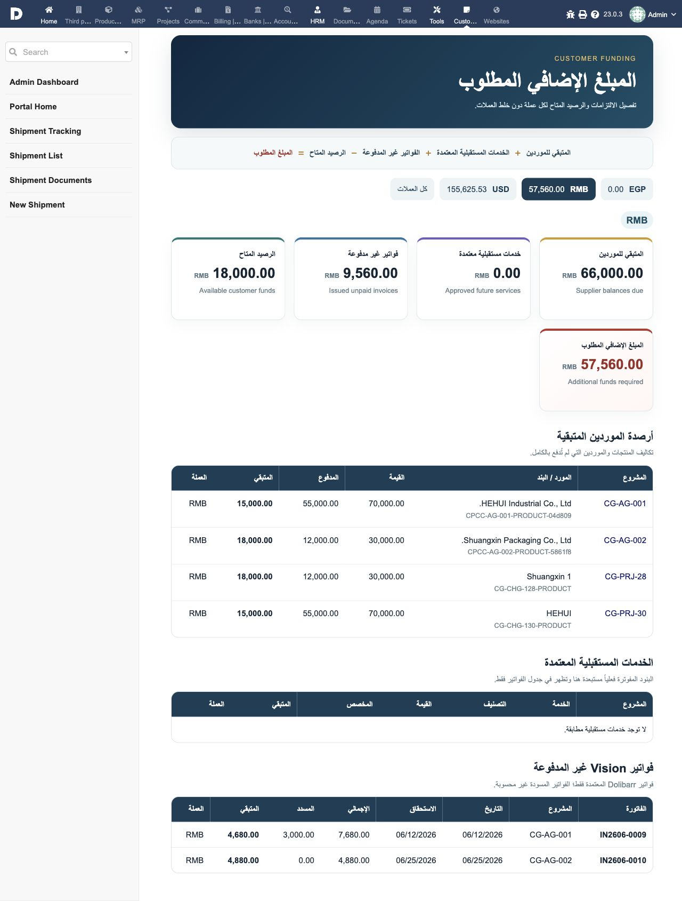

### تفسير النتيجة

- **صفر:** الرصيد المتاح يغطي الالتزامات الحالية.
- **رقم موجب:** هذا هو التمويل الإضافي المطلوب بهذه العملة.
- لا تخصم رصيد عملة أخرى إلا بعد تسجيل تحويل عملة رسمي.

## 7. فاتورة خدمات Vision

### متى نصدر الفاتورة؟

عندما تصبح الخدمة مستحقة أو مكتملة وفق الاتفاق مع العميل.

بنود نموذجية:

- Commission
- Shipping margin/management
- CargoX
- DHL
- Inspection
- Money management fee
- Other approved service

### ما الذي لا نضعه فيها؟

قيمة بضاعة المورد في حالة الوكالة لا تُعامل تلقائيًا كإيراد Vision.

### صفحة قائمة الفواتير

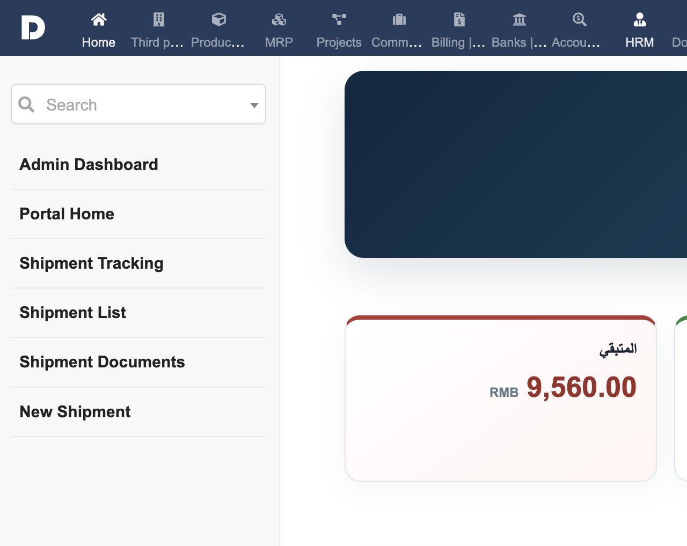

تعرض الصفحة:

- إجمالي الفواتير حسب العملة.
- المسدد.
- المتبقي.
- حالة كل فاتورة.
- المشروع المرتبط.

### صفحة تفاصيل الفاتورة

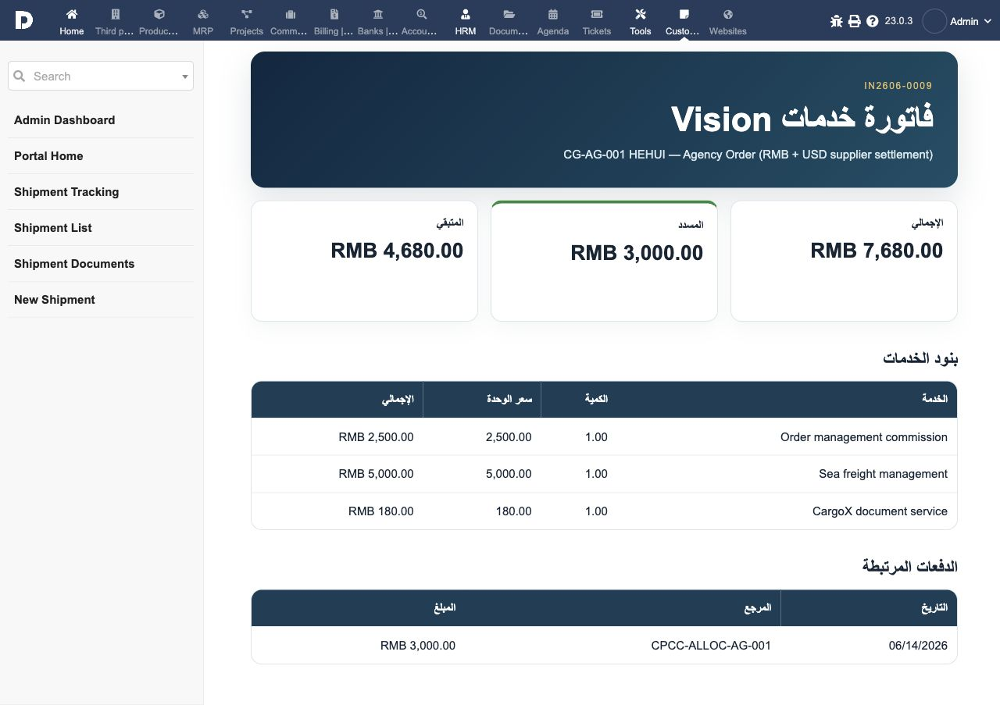

تعرض:

- بنود الخدمات فقط.
- الكمية وسعر الوحدة.
- الإجمالي.
- دفعات أو تخصيصات المحفظة المرتبطة.

### تخصيص رصيد المحفظة للفاتورة

إذا قررت الشركة خصم فاتورة Vision من أموال العميل المحتفظ بها:

1. أنشئ/اختر دفعة Dolibarr المرتبطة بالفاتورة.
2. سجّل **Invoice Allocation** في الطبقة المالية.
3. اربطها بدفعة Dolibarr نفسها.
4. لا تسجلها Customer Receipt جديدًا؛ فالمال دخل البنك سابقًا.

## 8. صفحة المشروع المالية

افتح المشروع من بطاقة Projects أو من مركز العمليات.

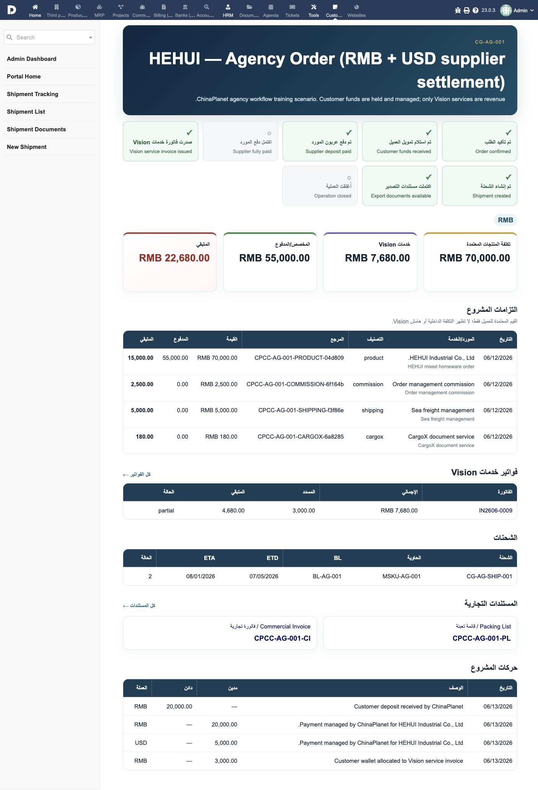

تجمع الصفحة في مكان واحد:

- حالة مراحل التشغيل.
- قيمة المورد والمدفوع والمتبقي.
- العمولة والشحن وCargoX والخدمات الأخرى.
- فواتير Vision.
- الشحنات.
- Commercial Invoice وPacking List.
- جميع حركات محفظة المشروع.

إذا رأيت فرقًا غير منطقي، راجع أولًا:

1. هل الحركة مرتبطة بالمشروع الصحيح؟
2. هل العملة صحيحة؟
3. هل دفعة المورد مرتبطة بالتزام المورد؟
4. هل تخصيص الفاتورة مسجل مرة واحدة فقط؟

## 9. كشف حساب العميل

افتح **Customer Statement / كشف الحساب** من لوحة العميل.


الأعمدة:

- Date
- Transaction Type
- Description
- Debit
- Credit
- Balance

### معنى Debit وCredit

- **Credit:** مال دخل إلى محفظة العميل، مثل Customer Receipt.
- **Debit:** مال خرج أو خُصص، مثل Supplier Payment أو Invoice Allocation.

### Total Balance in USD

هذه البطاقة تحول أرصدة EGP وRMB وUSD إلى USD للعرض المركزي فقط، باستخدام أسعار التحويل المحددة في النظام. لا تستبدل الأرصدة الأصلية ولا تنشئ قيد تحويل.

استخدم الأرصدة الأصلية لكل عملة لاتخاذ قرار الدفع.

## 10. الشحنات والوقت الحر

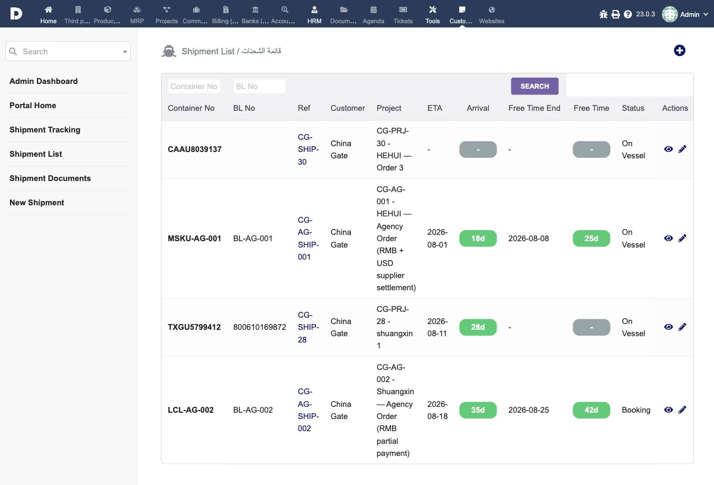

كل شحنة يجب أن ترتبط بـ:

- Customer
- Project
- Customer Order عند توفره
- Container/BL/Booking
- ETD/ETA/ATA
- Free Time Days
- Status

### Free Time التلقائي

عند تسجيل ATA وعدد أيام الوقت الحر:

```text
Free Time Start = ATA
Free Time End = ATA + Free Time Days
```

مثال:

```text
ATA: 14/07/2026
Free Time: 13 days
Start: 14/07/2026
End: 27/07/2026
```

إذا تغير ATA، احفظ الشحنة من جديد ليُعاد الحساب.

## 11. مستندات الشحنة ومستندات التصدير

يوجد نوعان مختلفان من المستندات:

### 11.1 Shipment Documents

ملفات مرفوعة مثل:

- BL scan
- Supplier PDF
- Inspection report
- Payment proof
- CargoX receipt

يتم تنزيلها من رابط آمن داخل البوابة، وتُعرض فقط لصاحب الشحنة.

### 11.2 Commercial Documents

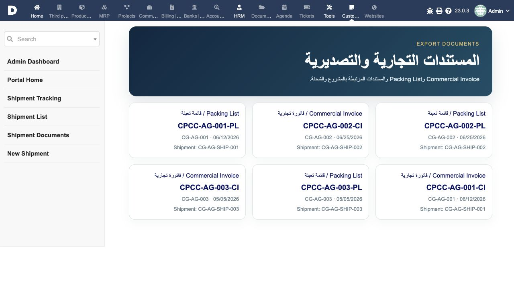

تشمل:

- Commercial Invoice
- Packing List
- Bill of Lading reference
- Certificate of Origin
- CargoX document
- Inspection document

### إنشاء مستند جديد

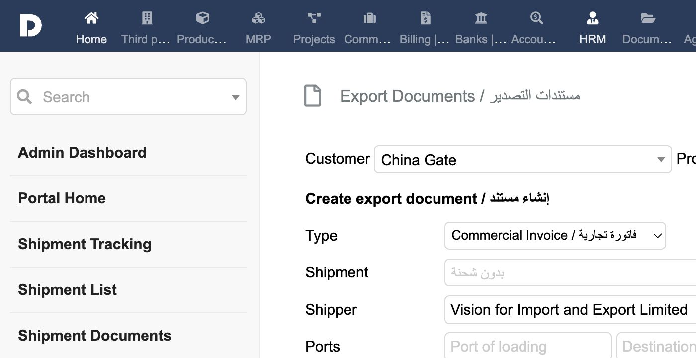

1. اختر العميل.
2. اختر المشروع.
3. اختر الشحنة إن وجدت.
4. اختر نوع المستند.
5. أدخل المرجع والتاريخ والعملة.
6. أدخل Shipper وConsignee والموانئ وIncoterm.
7. أضف البنود: الوصف، HS Code، الكمية، الوحدة، السعر، الكراتين، والأوزان.
8. فعّل **Customer Visible** فقط بعد مراجعة المستند.
9. احفظ ثم افتح المعاينة.

### معاينة Commercial Invoice

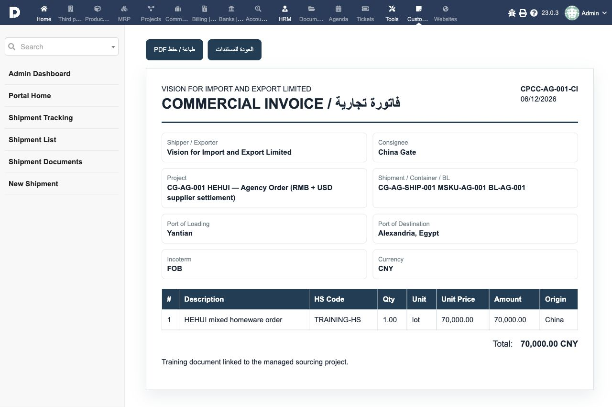

استخدم **Print / Save PDF** لإنشاء نسخة PDF بعد المراجعة.

## 12. لوحة العميل

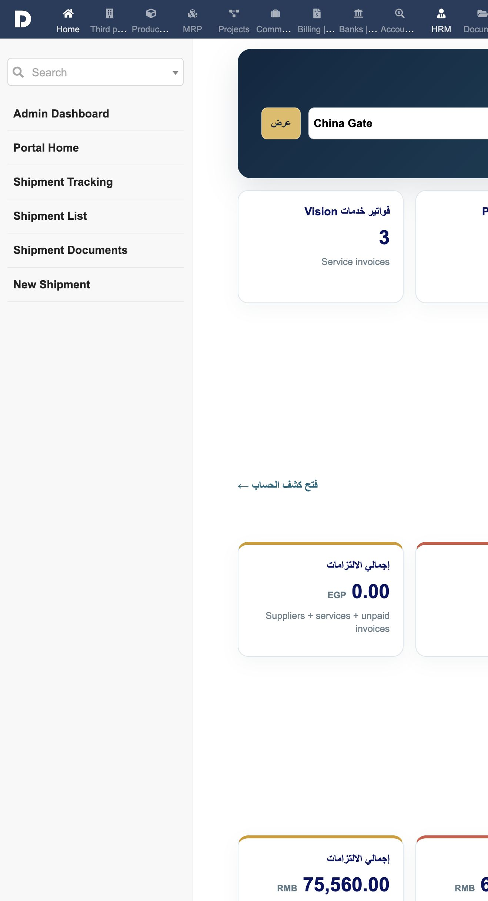

البطاقات التشغيلية:

- Active Shipments
- Completed Orders
- Projects: Active + Total
- Vision Service Invoices
- Export Documents

البطاقات المالية لكل عملة:

- Available Balance
- Total Received
- Total Spent
- Total Obligations
- Additional Funds Required

كل بطاقة قابلة للنقر وتفتح التفاصيل المفلترة للعميل نفسه.

## 13. سيناريوهات التدريب الجاهزة

### CG-AG-001 — HEHUI، دفع مختلط RMB وUSD

- قيمة المورد: 70,000 RMB
- مدفوع للمورد: 20,000 RMB + 5,000 USD
- تخصيص دفعة USD إلى المورد: 35,000 RMB
- إجمالي المسدد للمورد: 55,000 RMB
- المتبقي للمورد: 15,000 RMB
- فاتورة خدمات Vision: 7,680 RMB
- مخصص من المحفظة للفاتورة: 3,000 RMB
- الحالة: شحنة على السفينة، المورد غير مدفوع بالكامل

### CG-AG-002 — Shuangxin، RMB جزئي

- قيمة المورد: 30,000 RMB
- مدفوع: 12,000 RMB
- المتبقي: 18,000 RMB
- فاتورة خدمات Vision: 4,880 RMB
- الحالة: إنتاج/حجز، التمويل غير مكتمل

### CG-AG-003 — مورد USD، دورة مكتملة

- قيمة المورد: 10,000 USD
- مدفوع: 10,000 USD
- فاتورة خدمات Vision: 2,275 USD
- الفاتورة مخصصة بالكامل من المحفظة
- الشحنة والمستندات مكتملة

## 14. مراجعة نهاية اليوم للموظف

نفّذ القائمة التالية يوميًا:

- [ ] راجع التحويلات البنكية الجديدة وسجل Customer Receipts.
- [ ] اربط كل حركة بالعميل والمشروع الصحيحين.
- [ ] راجع دفعات الموردين وسجل العملة الفعلية والتخصيص.
- [ ] راجع Additional Funds Required لكل عملة.
- [ ] راجع فواتير Vision المفتوحة.
- [ ] حدّث ETD/ETA/ATA وحالة الشحن.
- [ ] راجع Free Time للشحنات القريبة من الوصول.
- [ ] ارفع المستندات الجديدة.
- [ ] لا تُظهر مستندًا للعميل قبل المراجعة.
- [ ] أغلق العمليات المكتملة فقط.

## 15. أخطاء شائعة وحلها

### يظهر رصيد غير صحيح

- ابحث عن حركة مكررة.
- تحقق من Direction.
- تحقق من العملة.
- تحقق من Invoice Allocation المكرر.

### المتبقي للمورد لا ينخفض

- تأكد أن Supplier Payment مرتبط بـ Charge/Commitment الصحيح.
- أدخل Allocated Amount بعملة فاتورة المورد.

### العميل يرى كل الشحنات أو المشاريع

- لا تستخدم روابط Dolibarr الداخلية في بوابة العميل.
- افتح صفحات Customer Center المفلترة.
- تأكد أن المستخدم الخارجي مرتبط بـ Third Party واحد.

### فاتورة العميل لا تظهر

- يجب أن تكون Validated وليست Draft.
- يجب أن يكون `Customer` صحيحًا.
- يجب ربطها بالمشروع إن كانت خاصة بمشروع.

### خطأ PDF أو شعار فارغ

- أضف شعار الشركة من `Home → Setup → Company`.
- لا تترك مسار صورة فارغًا.
- صفحة Customer Center تتجنب الآن توليد معاينة PDF عندما لا يوجد شعار.

## 16. قواعد الصلاحيات

- العميل الخارجي يرى بيانات Third Party المرتبط بحسابه فقط.
- تغيير `socid` يدويًا في الرابط لا يغير نطاق العميل.
- صفحات الطلب والمشروع والفاتورة والمستند تتحقق من ملكية السجل.
- الموظف الإداري فقط يمكنه إضافة الحركات أو المستندات.
- بيانات المورد الداخلية لا تُعرض للعميل إلا بالملخص المسموح.

## 17. تدريب موظف جديد

اليوم الأول:

1. اشرح الفرق بين Order وWallet وInvoice.
2. افتح CG-AG-001 وراجع المراحل.
3. اطلب منه تفسير دفعة 5,000 USD المخصصة إلى 35,000 RMB.
4. افتح فاتورة Vision ووضح أنها خدمات فقط.
5. افتح كشف الحساب وقارن Debit/Credit.

اليوم الثاني:

1. أنشئ مشروع تدريب جديد.
2. سجل إيداعًا تجريبيًا.
3. أنشئ التزام مورد.
4. سجل دفعة مورد جزئية.
5. أنشئ فاتورة خدمة وتخصيص محفظة.
6. أنشئ شحنة وCommercial Invoice وPacking List.

قبل منح صلاحية العمل الفعلي، يجب أن يستطيع الموظف شرح المعادلة التالية دون مساعدة:

```text
Supplier remaining + approved future services + unpaid Vision invoices
− available customer funds = additional funds required
```

## 18. الوصول السريع بعد تحديث الواجهة

- إنشاء مستند تصدير: من الشريط العلوي اختر `Export Docs / مستندات التصدير`، أو افتح المشروع في `Operations / العمليات` واضغط `إنشاء مستند تصدير / Create Export Document`.
- تغيير حالة الطلب: افتح `Operations / العمليات`، ثم قسم `حالة طلب العميل / Customer Order Status` واضغط **تفاصيل الطلب / Order details**. تبقى صفحة التفاصيل داخل تصميم لوحة التشغيل. عند الحاجة لتغيير حالة Dolibarr الأصلية اضغط **Dolibarr Advanced / فتح السجل المتقدم ↗**؛ يفتح في تبويب منفصل حتى تبقى لوحة التشغيل محفوظة في تبويبها.
- عرض كل الشحنات: من `Tracking / التتبع` اضغط `عرض كل الشحنات / Show all shipments`.
- فلترة الشحنات: بطاقات `In Transit` و`Arriving` و`Arrived` و`FT Critical` تعمل كفلاتر مباشرة.
- فلترة عميل: في `Shipments / الشحنات` و`Files / ملفات الشحن` استخدم قائمة العميل القابلة للبحث بالاسم، ولا تحتاج إلى معرفة رقم العميل.
- كشف حساب العميل: من `Portal / بوابة العميل` اضغط `كشف حساب العميل / Customer Statement` بجانب آخر الحركات.
- اتجاه الحركة المالية: `Customer payment` و`Opening balance` يظهران تلقائيًا `Credit / دائن`. المصروفات ودفعات الموردين والخدمات تظهر تلقائيًا `Debit / مدين`.
